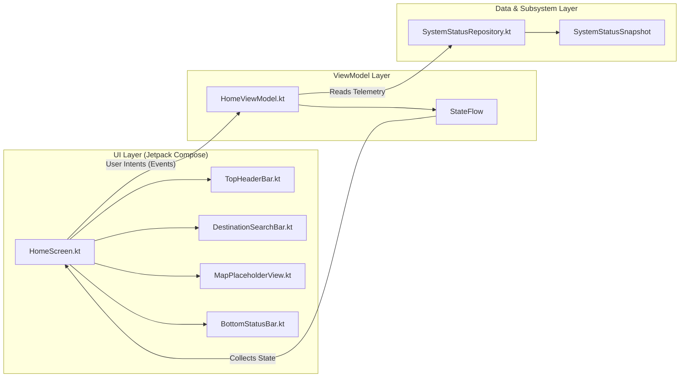
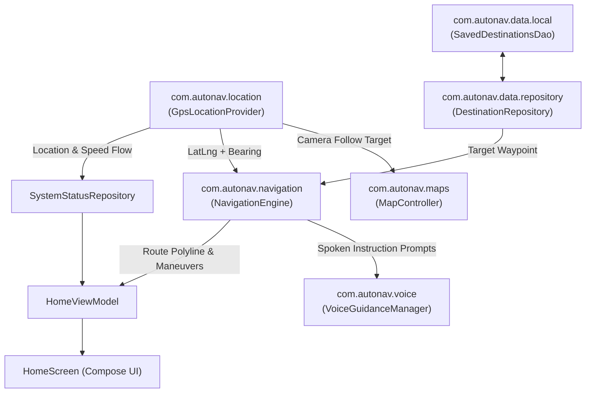

# AutoNav — Architecture Specification

This document details the software architecture of **AutoNav**, focusing on the Day 1 MVVM foundation and how subsequent hardware, mapping, routing, and voice subsystems plug into the existing structure.

---

## 1. Application Architecture Overview

AutoNav follows a layered **Model–View–ViewModel (MVVM)** architecture combined with **Unidirectional Data Flow (UDF)**. The application is divided into three primary rings of responsibility:

1. **UI Layer (`com.autonav.ui`)**: Stateless Jetpack Compose screens and reusable automotive components that render `HomeUiState` and forward user actions (search input, search submission, settings toggles) as lambda callbacks.
2. **State Management Layer (`com.autonav.viewmodel`)**: Lifecycle-aware `ViewModel` classes (`HomeViewModel`) that consume data streams from repositories, process UI intents, and expose a single immutable `StateFlow<HomeUiState>`.
3. **Data & Domain Layer (`com.autonav.data`, `location`, `maps`, `navigation`, `voice`)**: Repository interfaces and implementations (`SystemStatusRepository`, `DefaultSystemStatusRepository`) and domain models (`SystemStatusSnapshot`) that encapsulate subsystem state.

---

## 2. MVVM Explanation and Unidirectional Data Flow

To ensure reliability in an automotive environment where configuration changes, screen resizing, or multi-window split views can occur, AutoNav strictly separates state ownership from UI rendering:

- **Model (`SystemStatusSnapshot`, `SystemStatusRepository`)**:
  - Defined in `com.autonav.data.model.SystemStatus` and `com.autonav.data.repository.SystemStatusRepository`.
  - Represents the single source of truth for hardware and application readiness:
    - `GpsConnectionStatus` (`NOT_CONNECTED`, `SEARCHING`, `CONNECTED`)
    - `NavigationStatus` (`INACTIVE`, `CALCULATING_ROUTE`, `ACTIVE`, `REROUTING`)
    - `ApplicationStatus` (`INITIALIZING`, `READY`, `DEGRADED`)
  - On Day 1, `DefaultSystemStatusRepository` initializes deterministically with `NOT_CONNECTED`, `INACTIVE`, and `READY`, ensuring zero fake telemetry is ever emitted.

- **ViewModel (`HomeViewModel`, `HomeUiState`)**:
  - `HomeUiState` is an immutable Kotlin `data class` holding the current `searchQuery`, `pendingFeatureMessage`, `isSettingsDialogVisible`, and `systemStatus`.
  - `HomeViewModel` exposes `val uiState: StateFlow<HomeUiState>` and mutates state atomically via `_uiState.update { ... }` in response to explicit user events:
    - `onSearchQueryChanged(newQuery: String)`
    - `onSearchSubmitted()`
    - `onClearSearch()`
    - `onDismissPendingNotice()`
    - `onOpenSettings()` / `onDismissSettings()`

- **View (`HomeScreen`, `HomeScreenContent`, UI Components)**:
  - `HomeScreen` collects `viewModel.uiState` and delegates rendering to the stateless `HomeScreenContent` composable.
  - Because `HomeScreenContent` takes only plain data (`HomeUiState`) and event lambdas, it can be previewed across multiple automotive screen dimensions (`1280x720`, `800x480`, `1920x720`, `600x960`) and tested in isolation without mocking Android framework internals.

---

## 3. Package Responsibilities

| Package | Current Files | Responsibility |
| :--- | :--- | :--- |
| `com.autonav` | `MainActivity.kt` | Application activity entry point; configures edge-to-edge window insets, connects hardware GNSS lifecycle, and mounts `AutoNavTheme` + `HomeScreen`. |
| `com.autonav.ui.screens` | `HomeScreen.kt` | Top-level screen layout coordinator; computes responsive breakpoints via `BoxWithConstraints`, handles runtime location permission requests, and coordinates header, search, live map viewport, and telemetry bar. |
| `com.autonav.ui.components` | `TopHeaderBar.kt`, `DestinationSearchBar.kt`, `MapPlaceholderView.kt`, `BottomStatusBar.kt` | Modular, self-contained automotive UI controls with minimum `48dp`–`56dp` touch targets, speedometer telemetry display, and `testTag` hooks. |
| `com.autonav.ui.theme` | `Color.kt`, `Type.kt`, `Theme.kt` | Defines the low-glare dark charcoal color palette, high-contrast typography scale, and `AutoNavTheme`. |
| `com.autonav.viewmodel` | `HomeUiState.kt`, `HomeViewModel.kt` | State holder and intent processor for the Home Screen, tracking permissions, vehicle follow state, and telemetry. |
| `com.autonav.data.model` | `LocationFix.kt`, `SystemStatus.kt` | Domain models representing geographic coordinates, bearing, vehicle ground speed, and system status snapshots. |
| `com.autonav.data.repository` | `SystemStatusRepository.kt` | Repository interface and implementation streaming GPS telemetry, satellite counts, and speed to the UI layer. |
| `com.autonav.location` | `GpsLocationClient.kt`, `AndroidGpsLocationClient.kt` | Hardware GNSS sensor client interfacing with Android `LocationManager` and `GnssStatus` without Play Services dependency. |
| `com.autonav.maps` | `AutomotiveMapTheme.kt`, `AutoNavMapView.kt` | Google Maps Compose viewport, dark automotive styling JSON, vehicle heading reticle, and camera follow/re-center controls. |
| `com.autonav.navigation` | *(Reserved — Milestone 4)* | Route computation, polyline decoding, maneuver step progression, and off-route detection/rerouting engine. |
| `com.autonav.voice` | *(Reserved — Milestone 5)* | Android `TextToSpeech` controller managing audio focus and spoken turn-by-turn instructions. |
| `com.autonav.data.local` | *(Reserved — Milestone 6)* | Local persistence (Room database / DataStore) for saved destinations and recent route history. |
| `com.autonav.utils` | `AutomotiveClock.kt`, `SpeedFormatter.kt` | Formatting utilities for 24-hour cabin clock, m/s-to-km/h speed conversions, and compass cardinal headings. |

---

## 4. Data Flow Walkthrough (Day 1)

### Scenario A: Initial Application Launch
1. `MainActivity.onCreate()` sets content to `AutoNavTheme { HomeScreen() }`.
2. `HomeViewModel` is instantiated with `DefaultSystemStatusRepository()`.
3. `DefaultSystemStatusRepository.getInitialStatus()` returns:
   - `gpsStatus = GpsConnectionStatus.NOT_CONNECTED`
   - `navigationStatus = NavigationStatus.INACTIVE`
   - `applicationStatus = ApplicationStatus.READY`
4. `HomeScreen` collects `HomeUiState` and renders:
   - `TopHeaderBar` with live date/time from `AutomotiveClock`.
   - `DestinationSearchBar` with empty query and placeholder text.
   - `MapPlaceholderView` occupying `Modifier.weight(1f)` with the `MAP ENGINE PENDING` engineering notice.
   - `BottomStatusBar` displaying `GPS status: Not connected`, `Navigation status: Inactive`, and `Application status: Ready`.

### Scenario B: Driver Submits a Destination Query on Day 1
1. Driver types `"Kempegowda International Airport"` into `DestinationSearchBar` (`onSearchQueryChanged`).
2. `HomeViewModel` sanitizes newline characters and updates `HomeUiState.searchQuery`.
3. Driver presses the touch `Search` button or keyboard `ImeAction.Search` (`onSearchSubmitted`).
4. Because geocoding is scheduled for Milestone 3, `HomeViewModel` updates `pendingFeatureMessage` with an explicit notice:
   `"Destination search for \"Kempegowda International Airport\" is not yet active (Pending Milestone 3 geocoding integration)."`
5. `DestinationSearchBar` renders a non-intrusive notice bar below the search input with a `Dismiss` action, ensuring unimplemented functionality is transparently communicated.

---

## 5. Planned Module Interactions (Milestones 2–6)

- **Milestone 2**: `GpsLocationProvider` (`com.autonav.location`) will feed real connection states (`SEARCHING`, `CONNECTED`) into `SystemStatusRepository` and replace `MapPlaceholderView` with the live Google Maps composable in `com.autonav.maps`.
- **Milestone 3**: `DestinationSearchBar` submissions in `HomeViewModel` will call `DestinationRepository` instead of displaying the Day 1 pending milestone banner.
- **Milestone 4–5**: `NavigationEngine` (`com.autonav.navigation`) will transition `NavigationStatus` from `INACTIVE` to `CALCULATING_ROUTE` and `ACTIVE`, driving both visual turn cards in `ui.components` and spoken prompts in `com.autonav.voice`.
