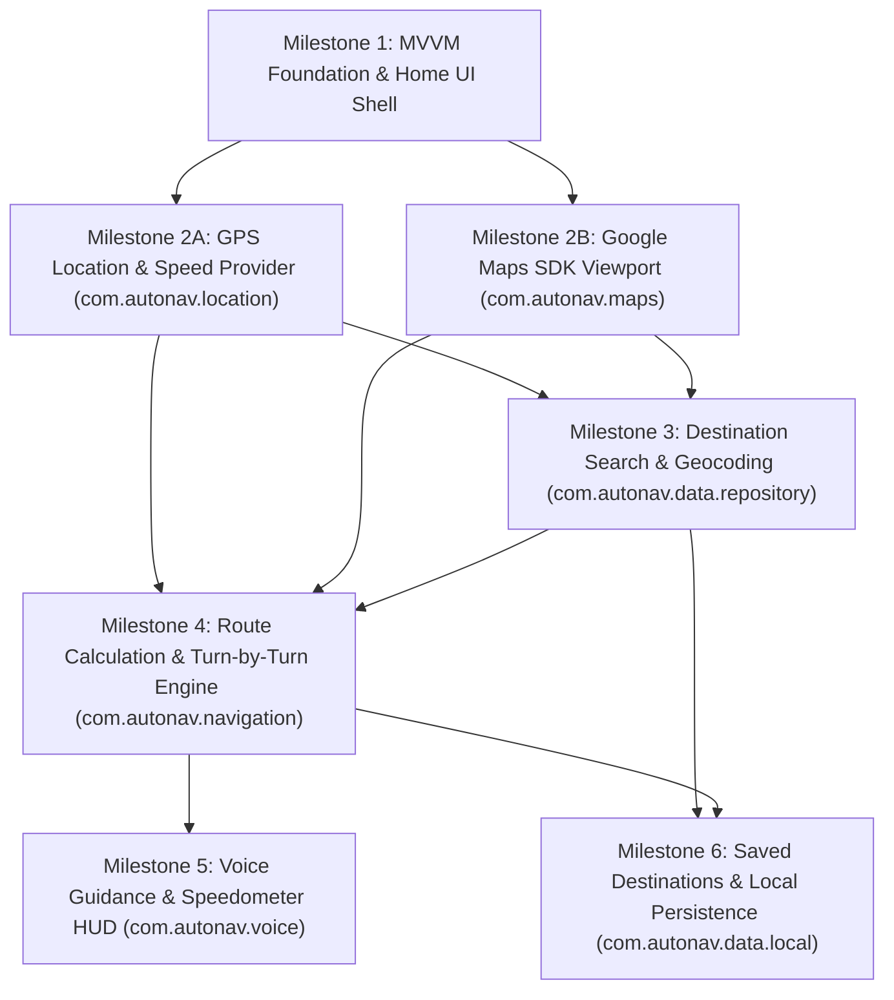

# AutoNav — Development Roadmap

This roadmap defines the engineering milestones, module dependencies, implementation order, testing requirements, and technical risks for the **AutoNav** standalone automotive navigation project.

---

## 1. Development Milestones

### Milestone 1: Project Foundation & Automotive UI Shell (Day 1 — Completed)
- **Scope**:
  - Initialize Git repository, Gradle version catalog (`gradle/libs.versions.toml`), and Android application module (`:app`, `com.autonav`).
  - Establish MVVM package structure (`ui`, `viewmodel`, `data`, `utils`, plus reserved packages for `location`, `maps`, `navigation`, `voice`, `data.local`).
  - Implement dark charcoal automotive theme (`AutoNavTheme`) and responsive landscape-first `HomeScreen`.
  - Implement `TopHeaderBar`, `DestinationSearchBar`, `MapPlaceholderView`, and `BottomStatusBar`.
  - Report truthful Day 1 subsystem states (`GPS status: Not connected`, `Navigation status: Inactive`, `Application status: Ready`).
  - Write unit tests (`SystemStatusRepositoryTest`, `HomeViewModelTest`, `AutomotiveClockTest`) and Compose UI test (`HomeScreenTest`).

### Milestone 2: GPS Location Telemetry & Map Viewport Integration (Day 2 — Completed)
- **Scope**:
  - Add runtime location permission handling (`ACCESS_FINE_LOCATION`, `ACCESS_COARSE_LOCATION`) and network permissions in `AndroidManifest.xml`.
  - Implement `GpsLocationClient` and `AndroidGpsLocationClient` in `com.autonav.location` wrapping Android's `LocationManager` and `GnssStatus` to emit real-time latitude/longitude, bearing, satellite fix status, and ground speed (`km/h`) without Play Services dependency.
  - Integrate Google Maps Compose in `com.autonav.maps` using `AutomotiveMapTheme` with dark low-glare styling, vehicle orientation reticle, and re-center controls.
  - Safe API key injection via `local.properties` (`MAPS_API_KEY`) into `manifestPlaceholders` and `BuildConfig.MAPS_API_KEY`.
  - Replace `MapPlaceholderView` with `AutoNavMapView`, retaining a graceful fallback state when permissions or API keys are pending.
  - Connect `GpsLocationClient` to `SystemStatusRepository` so `GPS status` updates dynamically (`Not connected` -> `Searching` -> `Connected`) and speedometer displays accurate ground speed.
  - Unit tests covering `LocationFix` geometry, `SpeedFormatter`, repository updates, and ViewModel state transitions (21 tests passing).

### Milestone 3: Destination Search & Geocoding (Day 3 — Completed)
- **Scope**:
  - Implement `Destination` domain model and `DestinationCategory` enums with straight-line distance formatting (`formatDistance`).
  - Implement `DestinationRepository` and `DefaultDestinationRepository` in `com.autonav.data.repository` resolving text queries into coordinates, ranking by text match relevance and proximity to current vehicle location (`LocationFix.distanceTo`).
  - Display search results in [`SearchResultsOverlay.kt`](file:///c:/in%20built%20navigation%20app%20in%20cars/app/src/main/java/com/autonav/ui/components/SearchResultsOverlay.kt) with touch targets $\ge 64dp$, category icons, and distance badges.
  - Build floating [`DestinationCard.kt`](file:///c:/in%20built%20navigation%20app%20in%20cars/app/src/main/java/com/autonav/ui/components/DestinationCard.kt) displaying selected waypoint details, straight-line distance, and route calculation actions.
  - Update `AutoNavMapView` to animate camera to selected destination and render custom target pin markers.
  - Wire search state, results overlay, and waypoint clearance in `HomeViewModel` and `HomeUiState`.
  - Comprehensive unit test suite (29 tests passing).

### Milestone 4: Route Calculation, Turn-by-Turn Guidance & Automatic Rerouting (Day 5–7)
- **Scope**:
  - Implement route request and polyline decoding in `com.autonav.navigation`.
  - Render active route polylines on the map viewport and transition `NavigationStatus` (`Inactive` -> `Calculating route` -> `Active`).
  - Build the turn-by-turn maneuver card (`NextTurnBanner`) displaying upcoming maneuver icon, street name, and remaining distance/ETA.
  - Implement off-route distance threshold detection: when vehicle GPS coordinates deviate beyond threshold from the active polyline, transition `NavigationStatus` to `Rerouting` and request an updated route automatically.

### Milestone 5: Voice Navigation & Vehicle Speed Display (Day 8)
- **Scope**:
  - Implement `VoiceGuidanceManager` in `com.autonav.voice` using Android `TextToSpeech` with automotive audio focus (`USAGE_ASSISTANCE_NAVIGATION_GUIDANCE`).
  - Trigger spoken announcements at configurable distance thresholds prior to each maneuver.
  - Add a dedicated real-time vehicle speedometer badge derived from live GPS speed telemetry (displaying `-- km/h` when GPS signal is unavailable).

### Milestone 6: Saved Destinations & System Settings Persistence (Day 9–10)
- **Scope**:
  - Implement Room database / Jetpack DataStore in `com.autonav.data.local` to persist favorite destinations (e.g., Home, Work, pinned locations) and recent searches.
  - Replace the Day 1 `SettingsPendingDialog` with functional preferences (voice guidance mute/unmute, speed unit `km/h` vs `mph`, map camera follow mode).
  - Perform end-to-end integration testing across multiple automotive display profiles.

---

## 2. Module Dependencies & Implementation Order

### Strict Ordering Rationale
1. **`location` and `maps` (Milestone 2)** must precede **Destination Search (Milestone 3)** and **Routing (Milestone 4)** because route computation requires an origin coordinate from the GPS sensor and a map canvas to render markers and polylines.
2. **Destination Search (Milestone 3)** must precede **Route Calculation (Milestone 4)** so the user can select a valid destination waypoint without hardcoded coordinates.
3. **Turn-by-Turn Engine (Milestone 4)** must precede **Voice Guidance (Milestone 5)** because spoken prompts are triggered by maneuver step transitions emitted by the navigation engine.

---

## 3. Testing Requirements

Every milestone must satisfy three levels of verification before completion:

1. **JVM Unit Tests (`app/src/test`)**:
   - All `ViewModel` state transitions, repository contracts, route math utilities, and formatters must have deterministic JUnit tests.
   - Day 1 baseline: `SystemStatusRepositoryTest`, `HomeViewModelTest`, and `AutomotiveClockTest`.
2. **Compose Instrumented UI Tests (`app/src/androidTest`)**:
   - Verify that critical UI controls render, maintain touch-target accessibility, and display accurate system status strings.
   - Day 1 baseline: `HomeScreenTest`.
3. **Multi-Viewport Landscape Verification**:
   - Verify layout integrity across:
     - Compact 7-inch head unit (`800x480` dp)
     - Standard 10–12 inch widescreen head unit (`1280x720` dp)
     - Ultra-wide cockpit display (`1920x720` dp)
     - Portrait tablet fallback (`600x960` dp)

---

## 4. Known Technical Challenges

1. **Standalone Hardware GPS Acquisition Latency**:
   - Embedded Android head units in vehicles often experience cold-start GNSS acquisition delays or signal multipath in urban canyons. The `com.autonav.location` module must distinguish between `NOT_CONNECTED` (hardware disabled/permission missing), `SEARCHING` (acquiring satellite fix), and `CONNECTED` (active fix with acceptable horizontal accuracy) so the UI never displays stale coordinates as live.
2. **API Key Security in Open-Source Repositories**:
   - Google Maps and Directions APIs require secret keys that must never be hardcoded in Kotlin source or `AndroidManifest.xml`. Milestone 2 will inject keys strictly from ignored `local.properties` via the Secrets Gradle Plugin or `BuildConfig` fields, with `local.properties.example` committed as documentation.
3. **Glanceability and Touch Ergonomics While Driving**:
   - Standard mobile UI patterns (small icon buttons, dense dropdowns, scrollable cards) are unsafe on an in-dash touchscreen. All interactive elements in AutoNav enforce a minimum `48dp`–`56dp` touch height, high-contrast off-white text on dark charcoal surfaces, and zero nested scrolling on the primary navigation screen.
4. **Automatic Rerouting Stability**:
   - Naive off-route detection can trigger repeated reroute loops when GPS accuracy fluctuates at intersections. Milestone 4 will require both a perpendicular cross-track distance threshold (e.g., `> 35 meters`) and consecutive off-route samples before triggering a recalculation.
